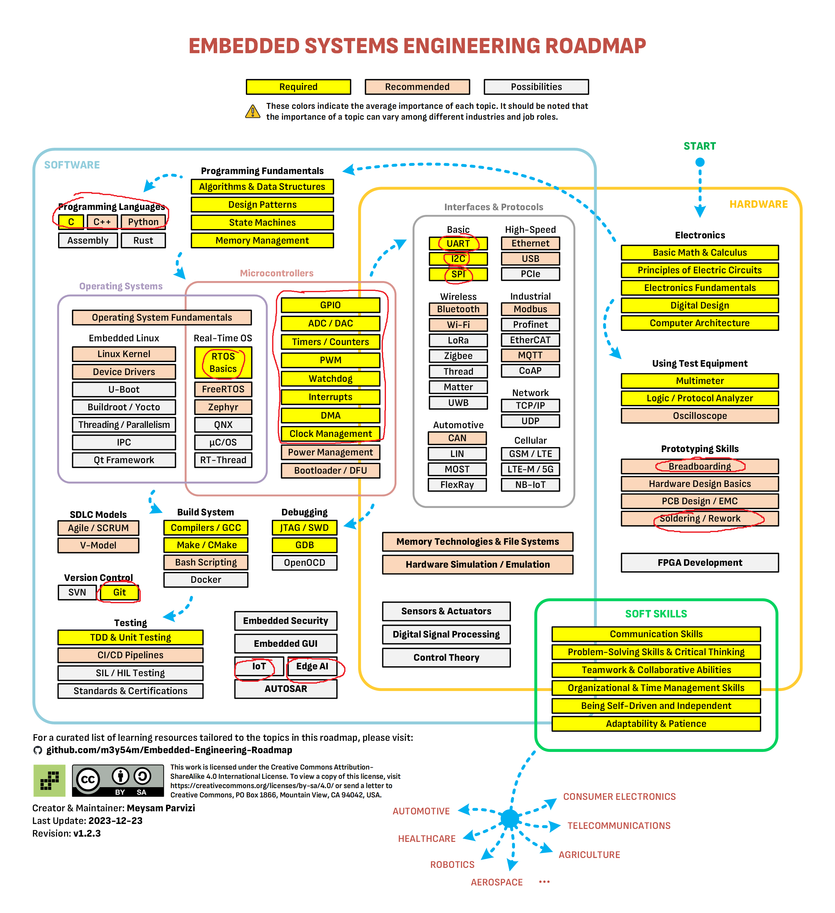
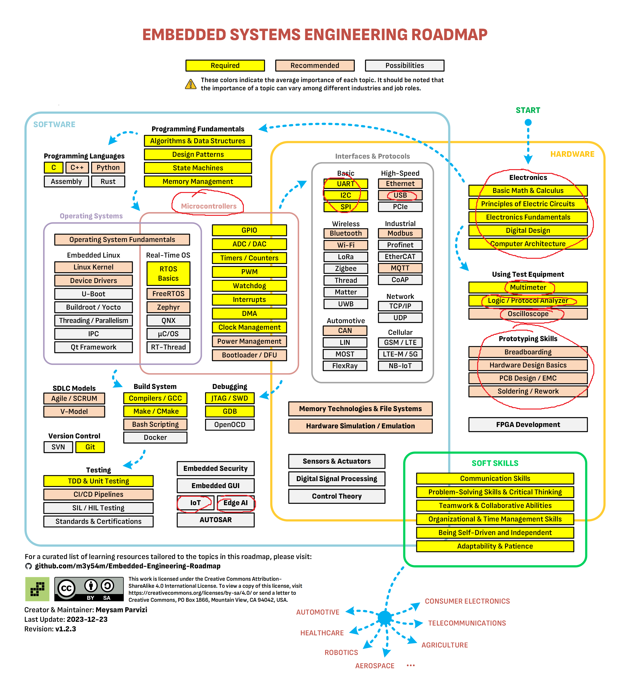

# Phụ lục: Sơ đồ kỹ năng ngành nhúng

Ba sơ đồ này cho bạn nhìn toàn cảnh ngành lập trình nhúng và thấy nền mình đang học nằm ở đâu.

**Đây là tài liệu tra cứu, không phải lộ trình học.** Mới vào thì đừng bắt đầu từ đây — bắt đầu ở [Bạn đang ở đâu](00-ban-dang-o-dau.md). Nhìn một bức tường 150 ô chữ khi chưa có nền thì chỉ thấy choáng.

---

## Cách đọc

Sơ đồ có **hai lớp ký hiệu chồng lên nhau**:

**Màu nền — của tác giả gốc.** Mức độ quan trọng của chủ đề trong toàn ngành nhúng: 🟨 vàng = Required · 🟧 cam = Recommended · ⬜ xám = Possibilities.

**Khoanh đỏ — của CLB.** Phần CLB chọn ra cho từng nền.

> **Khi hai lớp mâu thuẫn, ưu tiên khoanh đỏ.** Ô vàng không khoanh = quan trọng trong ngành nói chung nhưng chưa cần cho việc CLB đang làm. Ô xám mà được khoanh = CLB cần nó dù ngành coi là chuyên sâu.

> **Khi sơ đồ và file nền khác nhau, lấy theo file nền.** Sơ đồ là ảnh tĩnh, file nền được cập nhật thường xuyên hơn.

---

## Sơ đồ theo từng nền

### Firmware STM32

Khoanh đỏ tập trung vào khối vi điều khiển, giao tiếp cơ bản, và phần nền chung (C, Python, Git). Xem [nen-stm32.md](nen-stm32.md).

### ESP32 & Kết nối

So với sơ đồ STM32, phần khoanh mở rộng sang mạng: Wi-Fi, TCP/IP, UDP, MQTT và nhóm mạng di động. Xem [nen-esp32.md](nen-esp32.md).

### Hardware

Khoanh đỏ gồm khối Electronics, toàn bộ Prototyping Skills và các thiết bị đo. Xem [nen-hardware.md](nen-hardware.md).

---

## Ghi công và giấy phép

Ba sơ đồ trên là bản có chú thích thêm, dựa trên tác phẩm gốc:

> **Embedded Systems Engineering Roadmap**
> Tác giả: **Meysam Parvizi**
> Bản gốc: https://github.com/m3y54m/Embedded-Engineering-Roadmap
> Phiên bản v1.2.3, cập nhật 23/12/2023
> Giấy phép: [CC BY-SA 4.0](https://creativecommons.org/licenses/by-sa/4.0/)

**Thay đổi so với bản gốc:** UTT UAV Club thêm phần khoanh đỏ để đánh dấu các chủ đề tương ứng với từng nền. Nội dung, bố cục và màu sắc gốc giữ nguyên.

Theo điều khoản ShareAlike, ba ảnh có chú thích này cũng được phát hành theo **CC BY-SA 4.0**. Bạn được dùng lại và sửa đổi, với điều kiện ghi công tác giả gốc và giữ nguyên giấy phép cho bản phái sinh.

*Phần tài liệu còn lại trong repo do UTT UAV Club tự viết, không thuộc phạm vi giấy phép trên.*
